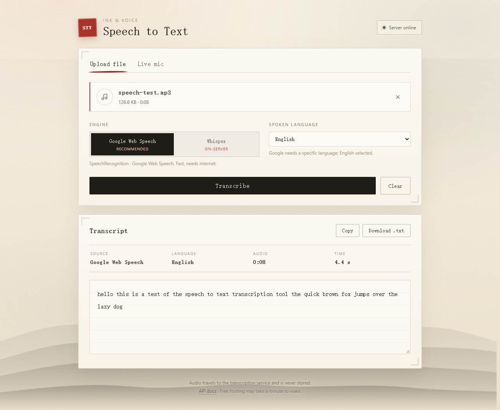
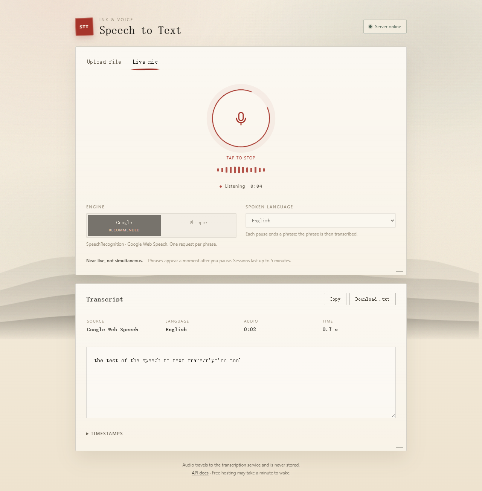

# Speech to Text — Ink & Voice

[](https://speechtotexteng.vercel.app)
[](https://speech-to-text-api-9ovp.onrender.com/health)
[](https://www.python.org/)
[](LICENSE)

A speech-to-text web app built for the **Speech-to-Text Transcription** assignment. Upload an
audio recording or speak into the microphone, and receive timestamped text in a light rice-paper
and ink-painting interface. The service uses Python speech-recognition libraries behind a FastAPI
API; the frontend is plain HTML, CSS and JavaScript with no build step.

- **Live demo:** https://speechtotexteng.vercel.app
- **API:** https://speech-to-text-api-9ovp.onrender.com — [`/health`](https://speech-to-text-api-9ovp.onrender.com/health), [`/docs`](https://speech-to-text-api-9ovp.onrender.com/docs)
- **Repository:** https://github.com/Darkstrike03/SPEECH

> The demo runs on free hosting. The first request after a period of inactivity can take up to a
> minute while the API wakes; the interface reports this instead of failing silently.

| Upload and transcript | Live microphone |
| --- | --- |
|  |  |

## Features

- Upload `wav`, `mp3`, `m4a`, `ogg`, `flac`, or `webm` — up to 25 MB / 5 minutes.
- Live microphone mode over WebSocket, one phrase per pause.
- Two engines selectable in the UI:
  - **Google Web Speech** through Python's `SpeechRecognition` (default; no API key).
  - **Whisper** through `faster-whisper` tiny running on the server (offline fallback).
- Automatic fallback from Google to Whisper when Google fails, with a visible warning.
- Timestamps, copy, download as `.txt`, language selection, input level meter, session timer.
- Light ink-painting theme: rice paper, grain, brush tabs, ensō microphone, red seal, mountains.
- Responsive layout, keyboard-accessible controls, reduced-motion support.

## How it works

```
Upload
  browser ──multipart──▶ FastAPI /api/transcribe
                         ├─ PyAV: any supported format → 16 kHz mono
                         ├─ google: SpeechRecognition → Google Web Speech
                         │          (45 s chunks with 300 ms tail padding)
                         ├─ whisper: faster-whisper tiny (warm model, int8)
                         └─ Google failure → Whisper fallback + warning

Live
  browser ──mic──▶ AudioWorklet (16 kHz int16 PCM) ──WebSocket──▶ /ws/stream
                         ├─ energy VAD endpointer (400 ms hangover)
                         ├─ one active session + five waiting clients
                         └─ completed utterance → worker thread → engine → final JSON
```

Audio is processed in memory and is not stored by the application.

## Engines and design choices

The brief asks for Python speech-recognition libraries. `SpeechRecognition` (Google Web Speech)
is the default because it is keyless, network-bound, and fast even on free hosting. Local
`faster-whisper` tiny (int8) is both the fallback and the second UI engine.

| Engine | Runs on | Default | Trade-off |
| --- | --- | --- | --- |
| Google Web Speech | Server via `SpeechRecognition` | Upload and live | Fast and keyless; needs internet; occasional word merging |
| Whisper tiny | Server via `faster-whisper` | Fallback / optional | Exact words; slow on free CPU |

Hosted Whisper on Render's free 0.1 CPU measured RTF 5.6–6.3, so it is not practical for live
mode there. Google Web Speech measured RTF 0.28–0.33 for uploads and 0.6–1.4 s per live phrase.
The app therefore defaults to Google for responsiveness and keeps Whisper as a safety net and an
exact-word option. No external API keys or secrets are required anywhere.

### Measured performance

| Where | Engine | Audio | Wall time | RTF |
| --- | --- | --- | --- | --- |
| Local desktop | Whisper tiny | 8.0 s | 0.84–0.90 s | 0.11 |
| Local desktop | Google | 8.0 s | 2.2–2.6 s | 0.28–0.33 |
| Render free | Whisper tiny | 8.0 s | 44.9–50.5 s | 5.6–6.3 |
| Render free | Google | 8.0 s | 2.07 s | 0.26 |
| Local live | Google | 2.7–2.9 s phrase | 0.62–1.41 s | — |
| Local live | Whisper tiny | 2.7–2.9 s phrase | 0.74–0.81 s | — |

RTF below 0.5 is smooth, 0.5–1 is demoable, and above 1 needs tuning. Whisper on Render is
roughly six times slower than real time; a one-minute upload takes about three minutes.

## Run locally

Requires Python 3.12 (the bundled `.venv` is 3.12.7) and a Chromium-based browser for live mode.
Always use the virtual environment's interpreter: `.\.venv\Scripts\python.exe`.

```powershell
# Terminal 1 — API
.\.venv\Scripts\python.exe -m uvicorn app:app --host 127.0.0.1 --port 8000 --app-dir backend

# Terminal 2 — web
.\.venv\Scripts\python.exe -m http.server 5500 --directory frontend
```

Open http://127.0.0.1:5500. `frontend/config.js` automatically targets the local API on port 8000
for localhost and the Render URL everywhere else.

Optional tools:

```powershell
# Transcribe a local file from the command line
.\.venv\Scripts\python.exe backend\cli.py samples\speech-test.wav --engine google

# Measure upload latency and real-time factor
.\.venv\Scripts\python.exe backend\benchmark.py samples\speech-test.mp3 --engine google

# Replay audio into the live endpoint
.\.venv\Scripts\python.exe backend\ws_test_client.py samples\speech-test.wav --realtime --engine google
```

## API

| Method | Path | Description |
| --- | --- | --- |
| `GET` | `/health` | Status, default engine, Whisper model, limits, queue size |
| `GET` | `/docs` | Interactive OpenAPI documentation |
| `POST` | `/api/transcribe` | Multipart `file`, `engine=google\|whisper`, `language` |
| `WS` | `/ws/stream` | Live 16 kHz PCM streaming |

### WebSocket contract

Client to server:

- First message within 15 s:
  `{"type":"start","language":"en","engine":"google"}`
- Binary frames: raw little-endian int16 PCM, mono, 16 kHz, any chunk size (100 ms recommended).
- `{"type":"ping"}` every 20 s as a keepalive.
- `{"type":"stop"}` to flush the open utterance and drain the queue.

Server to client:

- `queued`: `{position, max_wait_seconds}` — another session is active; wait for `ready`.
- `ready`: `{sample_rate, frame_ms, max_seconds, engine, whisper_model}` — start sending audio.
- `vad`: `{speaking: bool}`.
- `processing`: `{seq, start}` — an utterance was accepted.
- `final`: `{seq, text, start, end, language, engine, warnings, audio_seconds, elapsed, provider}`.
- `empty`: `{seq, start}` — the VAD segment contained no speech.
- `warning`: backlog or skipped segment; `error`: `{code, message}`.
- `pong` and `done`: `{dropped}`.

Error codes include `stream_full`, `live_queue_timeout`, `idle_timeout`, `too_long`,
`expected_start`, and engine failures. Audio is only sent after `ready`.

## Limits and behaviour

| Limit | Value |
| --- | --- |
| Upload size | 25 MB |
| Audio length | 5 minutes |
| Live session | 5 minutes |
| Live concurrency | 1 active session + 5 queued clients |
| Queue wait | 120 seconds |
| Idle live socket | Closed after 90 seconds without data |
| Upload rate | 30 requests per 10 minutes (global) |

Queued clients receive a queue position immediately, send no audio until `ready`, and are promoted
in FIFO order. A session that is abandoned or loses connectivity releases its slot through the
idle watchdog.

## Deploy

**Backend (Render):** `render.yaml` is a ready blueprint. It builds `backend/`, prefetches the
Whisper tiny model, and starts `uvicorn` on `$PORT` with `/health` as the health check. No secrets
are required. The free instance sleeps after inactivity, so the first request can be slow.

**Frontend (Vercel):** deploy `frontend/` as a static site with no build step. `config.js` points
non-local hosts at the Render API, and the backend allows `https://*.vercel.app` origins.

### Environment variables

| Variable | Default | Purpose |
| --- | --- | --- |
| `DEFAULT_ENGINE` | `google` | `google` or `whisper` |
| `WHISPER_MODEL_SIZE` | `tiny` | Local model size |
| `WHISPER_MODEL_DIR` | `models` | Model cache directory |
| `WHISPER_VAD` | `1` | VAD filter for uploads |
| `MAX_UPLOAD_MB` | `25` | Upload size cap |
| `MAX_AUDIO_SECONDS` | `300` | Upload duration cap |
| `MAX_STREAM_SECONDS` | `300` | Live session cap |
| `MAX_LIVE_QUEUE` | `5` | Waiting live clients |
| `LIVE_QUEUE_TIMEOUT_SECONDS` | `120` | Maximum queue wait |
| `STREAM_IDLE_TIMEOUT_SECONDS` | `90` | Dead-socket timeout |
| `RATE_LIMIT_REQUESTS` | `30` | Uploads per window |
| `RATE_LIMIT_WINDOW_SECONDS` | `600` | Rate-limit window |
| `ALLOWED_ORIGINS` | localhost + Vercel pattern | CORS allowlist |

## Known limitations

- Google's free endpoint occasionally merges words across a short pause (for example
  "tool. The" becomes "to all the") and can rate-limit datacenter IPs; the server falls back to
  Whisper automatically.
- Whisper on Render's free CPU is about six times slower than real time. It is correct, but an
  upload that takes one minute to say can take roughly three minutes to transcribe.
- Live text appears after a pause, not word by word: the VAD closes a phrase after 400 ms of
  silence, then the engine returns the final.
- Only one live session runs at a time; additional clients wait up to two minutes.
- Render cold starts can take up to a minute. The UI shows "waking the server" after six seconds
  and offers a clear error if the API does not answer within 60 seconds.
- Google recognition requires internet access. Whisper can run without it when the server is up.
- Uploads are decoded with PyAV, so no system ffmpeg installation is needed.

## Project structure

```
backend/
  app.py              FastAPI upload and WebSocket endpoints, limits, queue
  transcriber.py      PyAV decode, Google Web Speech, faster-whisper, fallback
  streaming.py        energy VAD endpointer with pre-roll and hangover
  cli.py              local file transcription
  benchmark.py        upload latency / real-time factor measurement
  ws_test_client.py   replay audio into the live endpoint
frontend/
  index.html          ink-painting layout
  styles.css          rice paper, grain, brush and seal styling
  app.js              tabs, upload flow, WebSocket client, results
  pcm-worklet.js      48 kHz microphone → 16 kHz int16 frames
  config.js           API base URL selection
docs/                 README screenshots
LICENSE               MIT license
render.yaml           Render deployment blueprint
```

`samples/` contains local test audio and is gitignored.

## License

Released under the [MIT License](LICENSE). Copyright (c) 2026 Sayantan Das.
